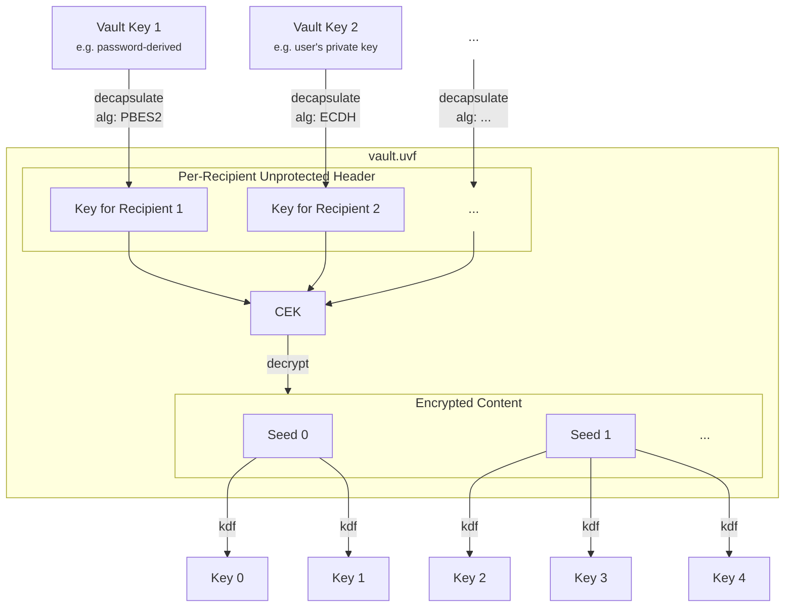

# Vault Metadata

Each vault contains one vault metadata file, which holds essential information like encryption parameters.

> [!NOTE]
> In order to decrypt this file, a _KEK_ is required. Retrieval of this _KEK_ is application-specific and the workflow is not part of this spec. The _KEK_ MAY change any time. Changing a _KEK_ alone does not revoke anything, see [Removing Recipients and Compromised KEKs](#removing-recipients-and-compromised-keks).

The vault metadata file is the entry point for vault access, as it contains the material required to derive the keys that all subsequent cryptographic operations depend upon:



## Filename and Location

The metadata file MUST be stored in the root directory of the encrypted vault structure for applications to retrieve it from remote storage without traversing deep hierarchies. Furthermore, it helps the user to understand the purpose of the directory.

The file SHOULD be named `vault.uvf`, however application vendors may decide to use custom names matching their brand or file extensions that are registered with their applications.

## File Format

The file is formatted in _JWE JSON Serialization_ format ([RFC 7516, Section 3.2](https://datatracker.ietf.org/doc/html/rfc7516#section-3.2)), as it is an easy-to-implement, flexible, broadly-used and mature standard that allows to store arbitrary public metadata in its header as well as sensitive data in its ciphertext.

> [!NOTE]
> While the _JWE Compact Serialization_ is more broadly adapted, the JSON serialization is more flexible, allowing multiple distinct vault keys or even vault key types to be used in parallel.

### JOSE Header

With this version of the UVF specification, the following registered header parameters are required:

| Location | Header Parameter | Allowed Values | Remark |
|---|---|---|---|
| Per-Recipient Unprotected Header | `alg` | any | Application-dependent |
| Per-Recipient Unprotected Header | `kid` | any, if prefixed | MUST use application-specific prefix in reverse-DNS notation, MUST be unique within the file and MUST have an entry in [`recipientDetails`](#recipient-details) |
| Protected Header | `enc` | `A256GCM` | Further encryption algorithms may be added in future revisions |
| Protected Header | `cty` | `json` | `application/json` formally correct but `application/` SHOULD be omitted [as per RFC 7515](https://datatracker.ietf.org/doc/html/rfc7515.html#section-4.1.10) |
| Protected Header | `crit` | `["uvf.spec.version"]` | |
| Protected Header | `uvf.spec.version` | `1` | To be increased with newer revisions of this spec |

`zip` MUST be absent (disallowing compression of the plaintext)

If required, further `alg`-specific header parameters MUST be added in the per-recipient unprotected header. Public keys of recipients MUST NOT be stored in any unencrypted part of the file, e.g. in a `jwk` header parameter; they belong into [`recipientDetails`](#recipient-details).

> [!IMPORTANT]
> Even if only a single recipient exists, it MUST be added to the `recipients` array. Consequently, `alg` and `kid` MUST NOT be part of the `protected` nor the `unprotected` header.

> [!NOTE]
> In order to comply with [RFC 7516, Section 4.3](https://datatracker.ietf.org/doc/html/rfc7516#section-4.3), any UVF-specific parameters, such as `uvf.spec.version` MUST be prefixed with `uvf.`.
>
> Application-specific parameters MUST be prefixed accordingly, e.g. using `com.example.`.

#### Example Protected Header

As the current version of this specification only allows for predefined parameter values, nothing but the parameter order may change. The base64url-encoded version of the protected header for spec version 1 should therefore always be this:

```json
"protected": "eyJlbmMiOiJBMjU2R0NNIiwiY3R5IjoianNvbiIsImNyaXQiOlsidXZmLnNwZWMudmVyc2lvbiJdLCJ1dmYuc3BlYy52ZXJzaW9uIjoxfQ"
```

#### Example Per-Recipient Unprotected Header

This is an example for the `recipients` section of the metadata file that contains two alternative methods that the `com.example` application employs in order to decapsulate the CEK.

```json
"recipients": [
    {
        "header": {
            "alg": "PBES2-HS512+A256KW",
            "kid": "com.example.vaultpassword",
            "p2s": "...",
            "p2c": "..."
        },
        "encrypted_key": "..."
    },
    {
        "header": {
            "alg": "ECDH-ES+A256KW",
            "kid": "com.example.userkey.42",
            "epk": {...}
        },
        "encrypted_key": "..."
    }
]
```

> [!TIP]
> Applications that produce a symmetric key in any other way, e.g. using Argon2 may use `"alg": "A256KW"`. It is recommended to document how a key is produced or where it is stored in order to avoid vendor lock-ins.

### Encrypted Content

The JWE Ciphertext decrypts to a JSON object (as denoted by the `cty` header). Any sensitive metadata MUST be added to this.

With this version of the UVF specification, the payload MUST contain at least the following data:

* `fileFormat` (immutable): The exact file format of each [encrypted file](../file%20content%20encryption/README.md)
* `nameFormat` (immutable): The exact format of encrypted [file names](../file%20name%20encryption/README.md)
* `seeds` (append-only, not empty): A map of IDs and seeds:
   * the value is the seed, i.e. the pre-key material, a sequence of 32 bytes generated by a CSPRNG
   * the key acting as ID, a sequence of 4 bytes derived from the seed using the [KDF](../kdf/README.md) (see [Seed IDs](#seed-ids))
* `initialSeed` (immutable): The ID of the initial seed (may be used for non-rotating keys)
* `latestSeed`: The ID of the most recently added seed. Used to derive keys for newly added files (changing it allows [key rotation](../security-considerations.md#key-rotation-does-not-re-key-existing-data))
* `kdf` (immutable): A (fast) [KDF](../kdf/README.md) to derive purpose-built subkeys from the seeds. The key length depends on `fileFormat` and `nameFormat`
* `kdfSalt` (immutable): A 32 byte random value for salting the [KDF](../kdf/README.md) which can in turn be used to generate further salts or IVs, avoiding reuse
* `recipientDetails`: A map of `kid` values to per-recipient details, see [Recipient Details](#recipient-details)

> [!NOTE]
> When values such as a byte sequences have no native representation in JSON, they are base64url-encoded without padding.

> [!IMPORTANT]
> Implementors MUST make sure to leniently parse this JSON object in regards to unknown fields. Further fields MAY be added for vendor-specific use.
> Vendor-specific fields MUST use reverse domain name notation to avoid collisions.
>
> If `fileFormat`, `nameFormat`, or `kdf` values are not defined in the version of this specification denoted by `uvf.spec.version`, it violates the specification, requiring the application to halt processing.

```json
{
    "fileFormat": "AES-256-GCM-32k",
    "nameFormat": "AES-SIV-512-B64URL",
    "seeds": {
        "DU3kfQ": "ypeBEsobvcr6wjGzmiPcTaeG7_gUfE5yuYB3ha_uSLs",
        "YuRlmw": "PiPoFgA5WUoziU9lZOGxNIu9egCI1CxKy3PurtWcAJ0",
        "q8ZMqw": "Ln0sA6lQeuJl7PW1NWiFpTOTogKdJBOUmXJloaJa78Y"
    },
    "initialSeed": "DU3kfQ",
    "latestSeed": "q8ZMqw",
    "kdf": "HKDF-SHA512",
    "kdfSalt": "NIlr89R7FhochyP4yuXZmDqCnQ0dBB3UZ2D-6oiIjr8",
    "recipientDetails": {
        "com.example.vaultpassword": {},
        "com.example.userkey.42": {
            "jwk": { "kty": "OKP", "crv": "X25519", "x": "..." }
        }
    },
    "org.example.customfield": 42
}
```

#### Seed IDs

The ID of a seed is a deterministic function of the seed value, namely the first 4 bytes of its 32 byte digest:

```ts
let seedDigest = kdf(secret: seed, len: 32, context: "seedDigest")
let seedId = seedDigest[0..4]
```

The ID is referenced in the plaintext [file header](../file%20content%20encryption/README.md#file-header) of every encrypted file and therefore public. The digest is a PRF output of the seed and reveals nothing about the seed or any key derived from it beyond the PRF assumption on the KDF, so clients can store it outside the vault to recognise seeds they have seen before (see [Seed Pinning](../implementation-notes.md#seed-pinning)). The 4 byte ID is too short to serve this purpose, as a colliding seed can be found by brute force.

Deriving IDs from seed values makes concurrent additions mergeable: the union of two `seeds` maps is well-defined, and a client that finds its own seed missing after a concurrent write can re-add it, which yields an identical entry.

#### Recipient Details

`recipientDetails` holds, for every element of the `recipients` array, an object keyed by the recipient's `kid`:

* For recipients whose `alg` wraps the CEK with a public key, the object MUST contain the recipient's public key as a JWK ([RFC 7517](https://datatracker.ietf.org/doc/html/rfc7517)) in a `jwk` member.
* For recipients whose `alg` uses a symmetric KEK, the object MUST NOT contain a `jwk` member.
* Further members MAY be added for vendor-specific use, using reverse domain name notation.

The recipient list is part of the encrypted payload for two reasons. First, the per-recipient unprotected headers are not covered by the JWE integrity protection, so an adversary with write access to the storage could replace a recipient's public key by its own and the next client writing the file would wrap the CEK for the adversary. Second, whoever knows a recipient's public key can author a `vault.uvf` that this recipient will decrypt successfully. Public keys of recipients are therefore confidential to the vault's members: they MUST NOT be stored in any unencrypted part of the file and MUST NOT be disclosed beyond the parties entitled to write `vault.uvf`. Clients MUST only use public keys from `recipientDetails` when wrapping the CEK (see [Writing](../implementation-notes.md#writing)).

## Validation and Writing

The checks a client performs on unlock and the rules it observes when writing `vault.uvf` are specified in the [Implementation Notes](../implementation-notes.md#vault-metadata).

## Removing Recipients and Compromised KEKs

A removed recipient, or whoever holds a compromised _KEK_, knows the CEK and all seeds contained in the payload at that time. Merely deleting the entry from the `recipients` array therefore protects nothing, even though the fresh CEK of the next write is no longer wrapped for it.

In both cases, a new seed MUST be added and set as `latestSeed` in the same write that removes the recipient.

This protects files and directories created afterwards, provided that clients enforce [Seed Pinning](../implementation-notes.md#seed-pinning): without it, the former key holder can restore the previous `vault.uvf` or author a new one for a public-key recipient and thereby undo the removal. It does not protect:

* data already written (see [Key rotation](../security-considerations.md#key-rotation-does-not-re-key-existing-data)),
* names of nodes added to pre-existing directories, since a directory's seed is immutable,
* content written to pre-existing files whose file header is retained, since the header references the old seed (see [Header retention](../file%20content%20encryption/AES-256-GCM.md#security-considerations)).

Whether to rewrite a pre-existing file with a new header (and thus under the new seed) when modifying it is left to the application, trading full re-encryption against continued exposure to the former key holder.
